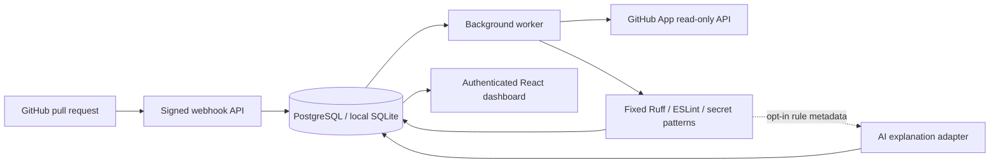

# CodeLens

**Understand every change. Review with confidence.**

An open-source, self-hosted pull request review assistant. CodeLens runs deterministic checks on changed Python, JavaScript, and TypeScript code and presents evidence in a focused review workspace. Optional AI explains rule metadata; humans make every decision.

**Status:** 0.1.0 local beta. Single-operator deployment. A reproducible demo is included. Live GitHub App setup requires your credentials; this repository does not claim production adoption or a completed third-party security audit.

## What works

- HMAC-SHA256 GitHub webhooks, repository/installation authorization, delivery and commit deduplication.
- A durable SQL job queue, background worker, bounded crash recovery, explicit run states, and retention cleanup.
- Commit-pinned source retrieval, added-line mapping, path validation, generated/sensitive file exclusions, and byte/file limits.
- Real Ruff and ESLint adapters with fixed configuration. No PR scripts, project plugins, or repository dependencies are executed.
- Narrow credential-format checks with redacted results. This is **not** a comprehensive secrets scanner.
- React dashboard with review selection, filters, severity labels, feedback, integration status, and light/dark themes.
- Optional, schema-validated AI explanations using only analyzer names, rule IDs, and severities. Disabled by default.
- Authentication, database migrations, automated tests, Docker Compose, and GitHub Actions.

## Quick start: Docker

Requirements: Docker Engine with Compose v2, Python 3.11+ for the secret-generation helper.

```sh
git clone <YOUR-REPOSITORY-URL>
cd codelens
python scripts/setup.py
docker compose up --build -d
```

Open **http://localhost:8000**. Copy `CODELENS_ADMIN_TOKEN` from your local `.env`, sign in, and select **Run sample review**. The worker reviews synthetic Python and TypeScript files through the real adapters. You should see an undefined Python name, `eval`, an unused import, a TypeScript unused variable, and loose equality. The sample is labelled and contains no real repository or credential data.

```sh
docker compose logs worker
docker compose down
```

The local Compose database password is a development-only value on an unexposed database service. For deployment, replace it, terminate HTTPS at a reverse proxy, and follow [SECURITY.md](SECURITY.md). Docker images and live external integrations require validation in your environment.

## Quick start: without Docker

Requirements: Python 3.11–3.13, Node.js 22+, npm.

```sh
python -m venv .venv
# macOS/Linux
source .venv/bin/activate
# Windows PowerShell: .\.venv\Scripts\Activate.ps1
pip install -c requirements.lock -e '.[dev]'
npm ci --prefix analyzer
npm ci --prefix web
python scripts/setup.py
alembic upgrade head
npm run build --prefix web
uvicorn codelens.api:app --host 127.0.0.1 --port 8000 --no-access-log
```

In a second terminal, activate the same virtual environment and run from the repository root:

```sh
python -m codelens.worker
```

The Python environment must be activated so the worker can locate `ruff`. SQLite is suitable for one local worker. Use PostgreSQL for deployment or multiple workers. For frontend development, run `npm run dev --prefix web`; Vite proxies `/api` to port 8000.

## Connect GitHub

1. Create a GitHub App with read-only **Contents**, **Pull requests**, and **Metadata** permissions. Subscribe to **Pull request** events. No write permissions are needed.
2. Set its webhook URL to `https://YOUR-HOST/api/v1/webhooks/github` and use the value of `CODELENS_WEBHOOK_SECRET`. Keep the dashboard private behind HTTPS.
3. Install the App on a selected repository. Record the installation ID from its installation URL.
4. Set `CODELENS_GITHUB_APP_ID`, `CODELENS_GITHUB_PRIVATE_KEY_PATH`, and `CODELENS_ALLOWED_REPOSITORIES=owner/repo` in `.env`. The private key is a file outside Git; never commit it.
5. For Docker, mount the key read-only in the **worker** using a Compose override (see [deployment guide](docs/deployment.md)). Restart services after environment changes.
6. In **Repositories**, enter `owner/repo` and its installation ID. Open a small PR or push a new commit. The dashboard polls every four seconds.

Run metadata records the exact head SHA. If the head changes during retrieval, that run fails safely; the synchronize event creates a new run. GitHub deliveries are idempotent for the retention window. Retry rejected queue-full deliveries manually from GitHub's delivery page.

## Configuration

`.codelens.yml` on the PR's **base commit** can narrow the operator configuration. PR changes cannot grant access, enable AI, add analyzers, or increase limits. Unknown configuration keys are rejected.

```yaml
version: 1
enabled: true
include: ["*"]
exclude: ["tests/*", "generated/*"]
analyzers: [ruff, eslint, secrets]
ai_enabled: false
max_files: 20
max_file_bytes: 100000
max_total_bytes: 500000
```

Patterns use case-sensitive Python `fnmatch` against repository-relative paths. Hard exclusions cannot be overridden. The total-byte limit counts source plus patches; missing/binary patches are skipped. Oversized or unreadable source causes a failed retrieval rather than a misleading clean review. The repository config API replaces the complete configuration, applying defaults to omitted fields.

## Optional AI

Set `CODELENS_AI_ENABLED=true`, configure `CODELENS_AI_KEY` and a compatible `CODELENS_AI_MODEL`, and enable AI for the repository. If a base `.codelens.yml` exists, it must also allow AI. The adapter sends **only rule metadata**, never source, diffs, paths, secret matches, or PR titles. Responses are validated and rendered as plain text labelled advisory. Provider failure produces a partial report while preserving deterministic findings. Provider retention is governed by your account terms. No automatic fixes or GitHub writes exist in this release.

## Development and tests

```sh
ruff check .
ruff format --check .
pytest --cov=codelens --cov-report=term-missing
npm test --prefix web
npm run build --prefix web
```

The Python suite covers signed webhooks, authorization, queue deduplication/recovery, diff mapping, real Ruff/ESLint execution, redaction, AI schema/data boundaries, GitHub retrieval limits, feedback persistence, deletion, and retention. External HTTP calls are mocked in tests. CI additionally builds Compose and runs the synthetic review inside the containers.

## Architecture



The API, worker, and adapters share a modular Python package. PostgreSQL acts as both storage and a durable queue, avoiding a separate Redis dependency and a database/queue dual-write failure. See [architecture decisions](docs/architecture.md), [security boundaries](SECURITY.md), and the [scope checklist](docs/scope.md).

## Contribute

Read [CONTRIBUTING.md](CONTRIBUTING.md), [CODE_OF_CONDUCT.md](CODE_OF_CONDUCT.md), and [ROADMAP.md](ROADMAP.md). Small, reproducible fixes are welcome. Candidate first issues include filter UI tests, expanded diff fixtures, and analyzer documentation. Report sensitive vulnerabilities privately using GitHub private vulnerability reporting once the maintainer enables it.

## Portfolio use

This is an original project, not evidence of a contribution accepted by another project's maintainer. Use the [portfolio guide](docs/portfolio.md) for accurate resume bullets, a demo script, and GitHub publishing steps. Add real measurements and links only after you have collected them.

Licensed under [Apache-2.0](LICENSE). CodeLens assists human review; it does not guarantee defect or vulnerability detection.
